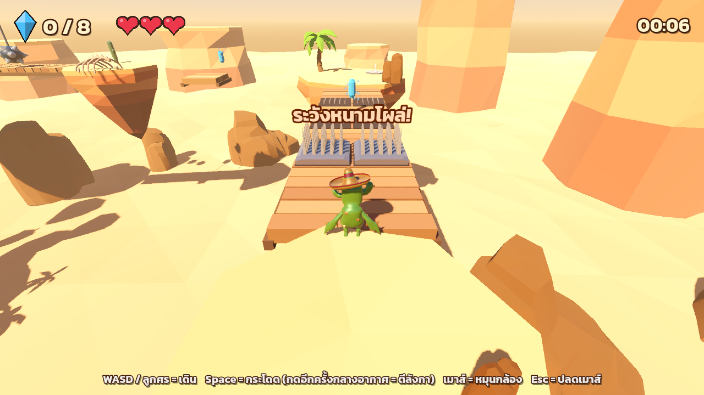
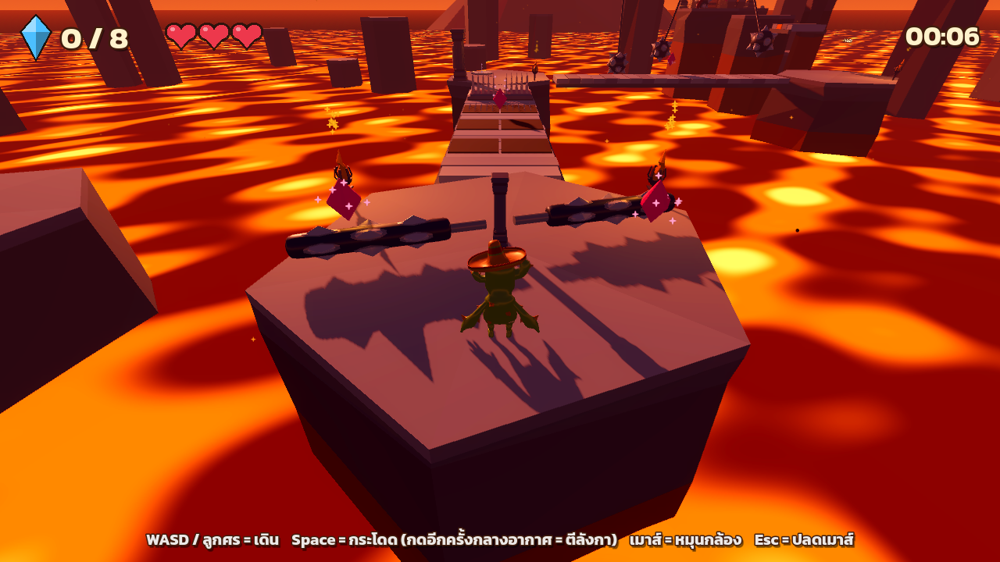

# Cactoro Oasis Quest (Lab 5: First 3D Game)

A 3D platformer made with **Godot 4.7** on top of the
[3D Platformer Starter Kit](https://store.godotengine.org/asset/the-silver-demons/platformer-3d-starter-kit/)
(The Silver Demons, CC0).

**Play in the browser:** https://super-super-dev.github.io/lab5_prod/

Help Cactoro the cactus bring water back to the desert: collect every crystal in the level,
avoid the traps, then walk through the door to reach the next stage.

## Controls

| Key | Action |
| --- | --- |
| WASD / arrow keys | Move |
| Space | Jump (press again in the air while moving = flip / double jump) |
| Mouse | Rotate the camera |
| Esc | Release the mouse (click the game to capture it again) |

## Levels

1. **หุบเขาทะเลทราย (Sun-Baked Canyon)**: floating sandstone mesas over a sea of dunes.
   8 water crystals; pop-up spikes, moving rafts, swinging spiky balls, a spinning spiked log,
   a rolling spiky ball, and a pillar that needs the flip jump. Exit through the oasis door.
2. **ซากวิหารลาวา (Lava Ruins)**: basalt columns over animated lava at dusk.
   8 fire crystals; faster spikes, a stone elevator, pendulums, a spinner and a rolling ball.

You have 3 hearts per level. Falling or touching a trap costs a heart; checkpoint flags
save your respawn point. The door stays locked until every crystal is collected.

## What changed from the starter kit

- **Player:** the Gobot model was replaced by **Cactoro** (Quaternius, from Poly Pizza).
  Its clips are remapped to the kit's animation names in `Assets/Animations/cactoro_anims.tres`:
  `Idle`, `Run`, `Jump`, `Flip` (built from Jump_Idle plus a full somersault of the root)
  and extra `Fall`, `Hurt`, `Death`, `Victory`, `Land`, `Walk`.
  `Assets/Models/fix_skeleton_import.gd` re-links the skinned mesh to its skeleton on import
  (otherwise the model stays in T-pose).
- `Scripts/player.gd` keeps the kit controller and adds hearts, knockback, respawn and a victory pose.
- New systems: `GameManager` (score, hearts, checkpoints, level flow, fades), HUD, title and win
  screens, door, checkpoints and traps (`Scripts/Traps/`).
- Levels, prefabs and menus are generated by `tools/build.gd` (low-poly flat-shaded meshes with vertex
  colors) and saved as normal `.tscn` files that can be edited in the editor.
  `tools/playtest.gd` checks platforms, pits, traps, gems, doors and level transitions.
- Renderer: GL Compatibility, so it runs on the web.

## Credits (all CC0)

- Starter kit: The Silver Demons, *3D Platformer Starter Kit*
- 3D models: Quaternius, Kenney and iPoly3D via [Poly Pizza](https://poly.pizza)
  (Cactoro, palm tree, cacti, rocks, gems, spikes, spiky ball, arch, door, temple, torch, column, crystal, bones)
- Sound effects: Juhani Junkala, *The Essential Retro Video Game Sound Effects Collection*,
  and Kenney, *Interface Sounds* (both from OpenGameArt); jump/coin/footsteps from the starter kit
- Font: Kanit (Cadson Demak, SIL Open Font License, `Assets/Fonts/OFL.txt`)
